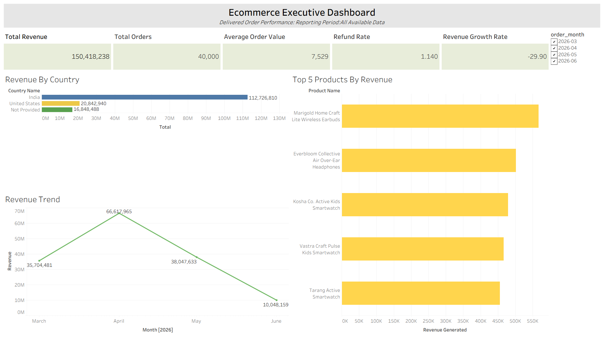

# Executive Ecommerce Dashboard
#### Author: Pallavi Jagare

## Project Overview

This project was developed to answer a CEO-style business question:

> "I should be able to look at the dashboard for 30 seconds and know if we're growing, where we're growing, and whether anything's broken."

Using SQL, PostgreSQL, and Tableau, an executive dashboard was created to provide a single-screen view of ecommerce performance. The dashboard combines revenue, order volume, customer spending, product performance, geographic performance, growth trends, and operational indicators to support fast business decision-making.


## Final Dashboard



## Tableau Dashboard

[ecommerce_Executive_Dashboard](./dashboards/Ecommerce_Executive_Dashboard.twbx)

## Business Questions Answered

### 1. Are We Growing?
- Total Revenue
- Total Orders
- Average Order Value (AOV)
- Revenue Growth Rate
- Revenue Trend

### 2. Where Are We Growing?
- Revenue by Country
- Top 5 Products by Revenue

### 3. Is Anything Broken?
- Refund Rate

## KPI Overview

| KPI | Purpose |
|------|---------|
| Total Revenue | Measures overall business performance |
| Total Orders | Tracks transaction volume |
| Average Order Value | Evaluates customer spending behavior |
| Revenue Growth Rate | Measures month-over-month growth |
| Revenue Trend | Shows revenue movement over time |
| Revenue by Country | Identifies top-performing markets |
| Top 5 Products by Revenue | Identifies strongest product contributors |
| Refund Rate | Highlights potential operational issues |


## Tools Used

- PostgreSQL
- SQL
- Tableau
- GitHub
- VS Code

---

# Iteration Story

## Rough First Draft

The first version of the dashboard focused on validating business logic rather than visual design.

Key characteristics:
- Default Tableau formatting
- Basic color palette
- Minimal spacing and alignment work
- Functional KPI cards and charts
- Focus on ensuring all planned KPIs were represented

The objective was to quickly validate whether the dashboard successfully answered the executive business questions before investing time in presentation improvements.


## Final Revision

Based on review and self-evaluation, the dashboard was refined while preserving the original analytical structure.

Changes included:
- Improved chart spacing and alignment
- Better dashboard organization
- Consistent KPI card presentation
- Cleaner labels and formatting
- Consolidation of missing country values into a single "Not Provided" category
- Enhanced readability without adding unnecessary visual complexity

The underlying KPI selections, SQL logic, chart types, and dashboard structure were intentionally retained because they continued to answer the core executive questions effectively.

## Key Insights

- Revenue performance peaked during April before declining in subsequent months.
- India generated the largest share of revenue, indicating strong market concentration.
- A small group of products contributed a significant portion of overall revenue.
- Refund Rate provides ongoing visibility into operational health and customer satisfaction.

## Repository Structure

```
dashboards/
├── requirements.md
├── kpi_plan.md
├── layout_sketch.md
├── draft_notes.md
├── design.md
├── executive_summary.md
├── ecommerce_dashboard_v1.twbx
└── screenshots/
    └── draft.png

sql/
├── total_revenue.sql
├── total_orders.sql
├── average_order_value.sql
├── revenue_growth_rate.sql
├── revenue_trend.sql
├── revenue_by_country.sql
├── top_5_products.sql
└── refund_rate.sql
```
